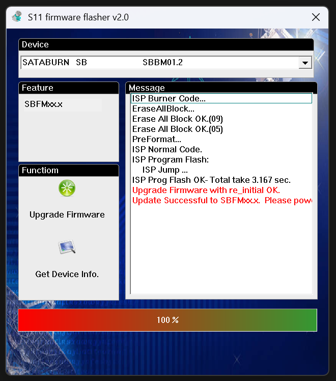

# Desbrickeo y Recuperación de SSD Phison PS3111-S11 (Toshiba 15nm MLC)

> Guía técnica, análisis de ingeniería inversa y herramientas para revivir discos de estado sólido basados en la controladora **Phison PS3111-S11** cuando quedan bloqueados en modo BootROM de 20 MB (`SBRM02.0`), superando las limitaciones del controlador AHCI de Windows 11 (`storahci`) mediante una **estrategia híbrida Linux/Windows** y parcheo binario del flasheador oficial.

---

## 1. El Hardware de Prueba

* **Dispositivo:** SSD Intenso Top Performance 2.5" SATA III 240 GB (PN: `3812440-711802002`).
* **Controladora:** Phison PS3111-S11-13 (arquitectura de 1 núcleo ARM, 32 KB SRAM interna).
* **Memoria NAND Flash:** **Toshiba 15nm MLC** (Flash ID: `98 3c a5 93 7e 51 08 44` en las 8 CEs).
* **Firmware de fábrica:** Familia `SBFM01.2` (compilación 08/08/2018).

---

## 2. El Problema (The Brick)

El síntoma típico de estos SSDs es que dejan de detectarse en el sistema o se identifican en BIOS como:
* **Modelo:** `PS3111`
* **Firmware:** `SBRM02.0`
* **Capacidad:** `20 MB` o `0 MB`

### Causa Raíz
La memoria NAND contiene un bloque reservado denominado **InfoBlock**, donde residen los metadatos de configuración, particionado y tablas de defectos de fábrica. Cuando el InfoBlock se corrompe (por un corte de energía abrupto o desgaste del bloque de arranque), la controladora no encuentra la firma válida `PhIsOn` en la flash y cae a su **modo de rescate en Mask-ROM (BootROM)**.

---

## 3. El Callejón sin Salida de las Herramientas Estándar

Para restaurar el SSD se necesita:
1. Cargar en la SRAM un cargador de arranque intermedio (**Burner Code** `SBBMxx.x`).
2. Formatear la NAND a bajo nivel, escanear bloques malos y compilar un nuevo InfoBlock (**PreFormat**).
3. Grabar el firmware definitivo en las páginas de la NAND (**ISP Normal Code**).

### La Paradoja de los Dos Entornos
* **En Linux:**  
  Herramientas como `psychite` o scripts de bajo nivel con `SG_IO` pueden comunicarse por comandos ATA directos y cargar el Burner a la SRAM sin problemas. Sin embargo, **no disponen del compilador de tablas de traducción del MPTool** de Phison necesario para regenerar el InfoBlock completo y mapear las 8 CEs de memoria flash.
* **En Windows:**  
  El software oficial de fábrica (`DLMC.exe` / `fw_sbfm012.exe`) contiene todo el motor del MPTool, pero:
  1. **Bloqueo de Windows 11 storahci:** Al intentar transferir los 512 KB del Burner a la SRAM por SATA nativo, el driver estándar AHCI de Microsoft (`storahci`) bloquea los paquetes multisector no estándar. La herramienta se congela o lanza el error:  
     `ISPProgramPRAM failed on Section_0, Loop_...` (Progreso al 15%).
  2. **Rechazo al modo Burner:** Si se intenta cargar el Burner previamente desde Linux, la herramienta de Windows detecta que el disco ya está en modo Burner (`SBB`) y **aborta nada más abrirse** con el mensaje:  
     `Run under Burner Code mode, re-plug SSD power again !!!`.
  3. **Requisito artificial de BootROM:** Al 10%, la herramienta vuelve a comprobar si la cadena reportada es estrictamente `SBRM`, abortando si no lo es (`Failed!!! Not Running on Boot Code now !!`).
  4. **Cuelgues de memoria (BEX / DEP / c0000005):** Si se puentean los pasos anteriores de forma ingenua, el programa intenta saltar a la función de autenticación de contraseña ATA (`HandShake`) con punteros de pila desinicializados, provocando un fallo de página que cierra la aplicación de golpe sin dejar ningún registro.

---

## 4. La Solución: Estrategia Híbrida Linux -> Windows (Warm Reboot)

Dado que la SRAM de la controladora Phison solo pierde los datos si se corta la alimentación de 5V, la solución definitiva consiste en:

```
[ SSD Brickeado (PS3111 / SBRM02.0) ]
                  │
                  ▼  (1) En Linux por SATA nativo
[ cargar_burner.py inyecta SBBM01.2 en SRAM ]
                  │
                  ▼  (2) Reinicio en caliente sin cortar energía (sudo reboot)
[ Windows 11 arranca; SSD sigue en SRAM como SATABURN SB ]
                  │
                  ▼  (3) Ejecutar flasheador con parche quirúrgico
[ fw_sbfm012_directo.exe flashea NAND y reconstruye InfoBlock ]
                  │
                  ▼  (4) Apagado en frío
[ SSD Recuperado a 240 GB con Firmware SBFM01.2 ]
```

---

## 5. El Parche Binario Explicado (Reverse Engineering)

El script `patch_flasher.py` modifica el ejecutable oficial `fw_sbfm012.exe` en 4 puntos exactos:

| Parche | Offset en archivo | Código Original | Código Parcheado | Explicación Técnica |
|---|---|---|---|---|
| **1. Bypass Burner inicial** | `0xfc6f` | `8b 01 8b 10 6a 01 ff d2...` | `e9 71 fe ff ff` (`jmp 0xfae5`) + 29 NOPs | En lugar de mostrar el cuadro de diálogo de error de modo Burner, salta a la inicialización normal de buffers de configuración. |
| **2. Bypass BootROM 10%** | `0xfb5e` | `6a 00 e8 7b 20 00 00 84 c0...` | `e9 2e 01 00 00` (`jmp 0xfc91`) + 10 NOPs | Salta la llamada a `0x11be0(0)` que exigía la cadena `SBR`, saltando directo al bloque del 15%. |
| **3. Bypass ISPProgramPRAM** | `0x14620` | `55 8b ec` (`push %ebp; mov %esp,%ebp`) | `b0 01 c3` (`mov $1, %al; ret`) | Hace que la función de subida a SRAM retorne éxito inmediatamente. Evita que Windows 11 intente enviar ráfagas multisector por `storahci` (el Burner ya está en SRAM). |
| **4. Salto directo a 30%** | `0xfd2b` | `8d 4d e0 51 8b` (`lea -0x20(%ebp), %ecx...`) | `e9 8e 00 00 00` (`jmp 0xfdbe`) | Salta limpiamente a la llamada de `ReadSystemInfo` (`0x12800`), evitando consultas de contraseñas ATA y llamadas a `HandShake` con punteros nulos. |

---

## 6. Procedimiento Paso a Paso

### Requisitos
1. Conectar el SSD brickeado mediante **cable SATA nativo** a la placa base del PC (no utilizar adaptadores USB para el paso final).
2. Un equipo con arranque dual **Linux / Windows** (o pendrive con live Linux y arranque a Windows).

### Paso 1: En Linux — Inyección del Burner
1. Comprueba el estado del disco:
   ```bash
   sudo python3 diagnostico_s11.py /dev/sdX
   ```
2. Carga el cargador en la SRAM:
   ```bash
   sudo python3 cargar_burner.py /dev/sdX firmware/SBFM01.2_08082018.BIN
   ```
3. El disco reportará: `SATABURN SB`, firmware `SBBM01.2`.

### Paso 2: Reinicio en caliente (*Warm Reboot*)
**NO apagues la fuente de alimentación ni mantengas pulsado el botón de encendido.**
Configura el arranque hacia Windows y reinicia por software:
```bash
sudo efibootmgr -n 0000   # Si usas UEFI con Windows Boot Manager
sudo reboot
```

### Paso 3: En Windows — Flasheo definitivo
1. Genera el ejecutable parcheado con Python:
   ```bash
   python3 patch_flasher.py fw_sbfm012.exe fw_sbfm012_directo.exe
   ```
2. Ejecuta `fw_sbfm012_directo.exe` como **Administrador**.
3. Selecciona la unidad `SATABURN SB` y pulsa en **Upgrade Firmware**.
4. La barra de progreso avanzará limpiamente:
   - *EraseAllBlock... (09, 05)*
   - *PreFormat... (escritura de nuevo InfoBlock)*
   - *ISP Normal Code (grabación del firmware SBFM01.2)*
   - Progreso al **100%** en verde.



### Paso 4: Apagado en frío
Apaga el PC por completo, espera 15 segundos y vuelve a encenderlo para que la controladora inicialice el firmware permanente desde la flash.

---

## 7. Resultados y Pruebas de Estrés

Tras completar el procedimiento, el disco fue probado en Linux:

```text
=== SMART Data ===
Device Model:     SATA SSD
Serial Number:    1118076A1011363B3F07
Firmware Version: SBFM01.2
User Capacity:    256.060.514.304 bytes [256 GB / 238,5 GiB]
SMART Status:     PASSED
SSD Life Left:    100%
Temperature:      33 °C
Raw Read Errors:  0
```

* **Lectura Secuencial:** **535 MB/s** (saturación de SATA III 6.0 Gb/s).
* **Escritura Secuencial:** **409 MB/s** (`fdatasync`).
* **Prueba de Integridad (SHA-256):** Escritura y lectura de bloque de 2.048 MB con vaciado total de caché (`drop_caches`), resultando en coincidencia exacta bit a bit.

---

## 8. Contenido del Repositorio

* `patch_flasher.py`: Script para parchear automáticamente `fw_sbfm012.exe`.
* `cargar_burner.py`: Script para inyectar el Burner a la SRAM en Linux.
* `diagnostico_s11.py`: Utilidad para consultar el modo de la controladora y Flash ID por `SG_IO`.
* `firmware/`: Binarios de firmware oficial Phison S11 (`SBFM01.2_08082018.BIN`, `SBFM01.1_24082017.BIN`).
* `img/`: Capturas del fallo inicial al 15% y del flasheo al 100%.

---

## Licencia y Descargo de Responsabilidad

Este proyecto se distribuye bajo la licencia MIT con fines educativos y de recuperación de hardware. No nos hacemos responsables de pérdidas de datos resultantes del formateo o uso indebido de comandos de ingeniería de bajo nivel en unidades que contengan datos no respaldados.
